# How Tincan works

Tincan has two halves that never talk to each other directly. A library inside the app under review
writes notes to a folder; a command that an agent runs reads them from the same folder. The folder is
the whole interface between them, so either half can be replaced, and the agent never needs the app to
be running.

- [The whole system](#the-whole-system)
- [Packages and targets](#packages-and-targets)
- [Review mode, from start to stop](#review-mode-from-start-to-stop)
- [Leaving a note](#leaving-a-note)
- [Finding the element under the pointer](#finding-the-element-under-the-pointer)
- [Taking the screenshots](#taking-the-screenshots)
- [Coordinates](#coordinates)
- [Keys and the pointer](#keys-and-the-pointer)
- [Pins and the menu bar switch](#pins-and-the-menu-bar-switch)
- [The floating bar](#the-floating-bar)
- [Where notes are stored](#where-notes-are-stored)
- [The note on disk](#the-note-on-disk)
- [An agent working through notes](#an-agent-working-through-notes)
- [Sending a note to a listening agent](#sending-a-note-to-a-listening-agent)
- [The MCP server](#the-mcp-server)
- [Threads and actors](#threads-and-actors)
- [What Tincan deliberately does not do](#what-tincan-deliberately-does-not-do)

## The whole system

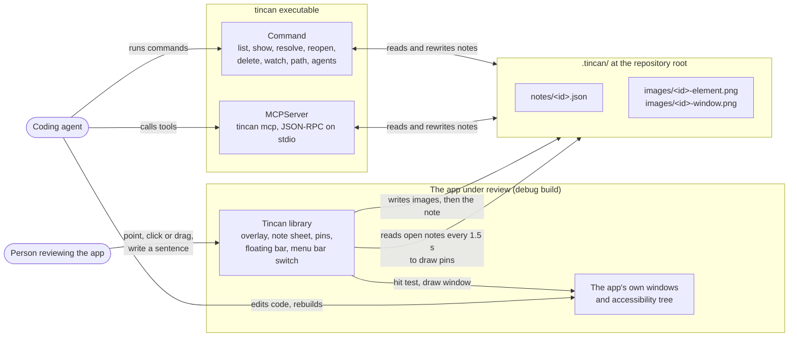

The app and the command agree on the folder by running the same resolution rule
([Where notes are stored](#where-notes-are-stored)), not by talking to each other.

## Packages and targets

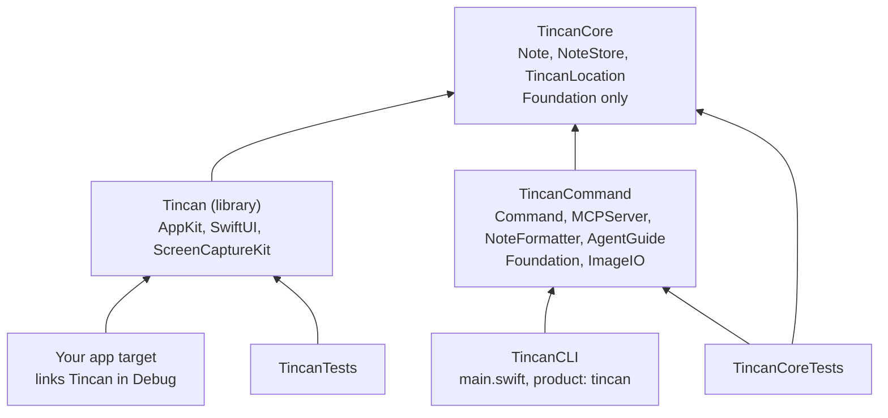

| Target | Product | Depends on | Holds |
|---|---|---|---|
| `TincanCore` | library `TincanCore` | Foundation | The note format, the store, the folder rule. Shared by both halves. |
| `Tincan` | library `Tincan` | `TincanCore`, AppKit, SwiftUI, ScreenCaptureKit | Everything that runs inside the app. |
| `TincanCommand` | none | `TincanCore`, ImageIO | The command and the MCP server, kept out of `main.swift` so tests can drive them. |
| `TincanCLI` | executable `tincan` | `TincanCommand` | One line: run the command with the process arguments. |

The executable target is named `TincanCLI` rather than `tincan` because macOS file systems are case
insensitive, and `Sources/tincan` would be the same folder as `Sources/Tincan`.

## Review mode, from start to stop

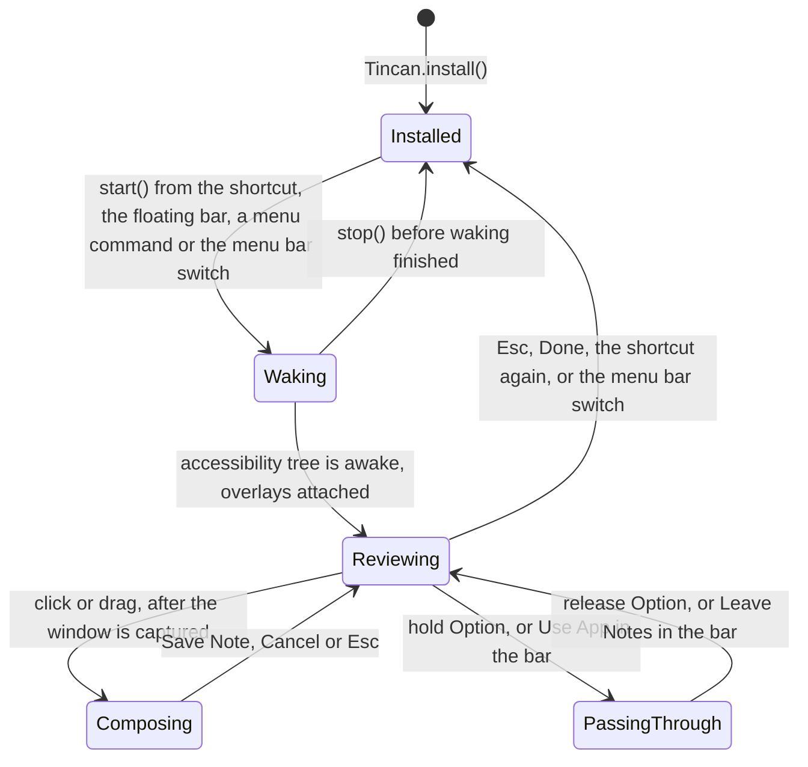

`install` creates the store, the menu bar switch and the shortcut monitor once. Each `start` creates a
fresh `ReviewSession`; `stop` tears all of it down: overlays, observers, the key monitor, the pin timer
and any open note sheet.

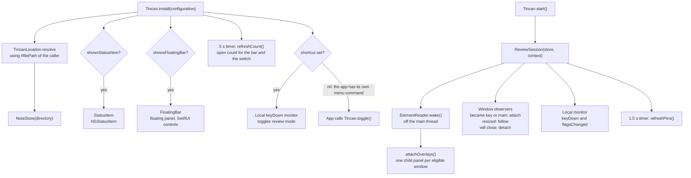

A window is eligible when it is visible, titled, at the normal level, has a content view, and is not
itself a panel. That keeps overlays off menus, popovers, the note sheet and Tincan's own panels.

## Leaving a note

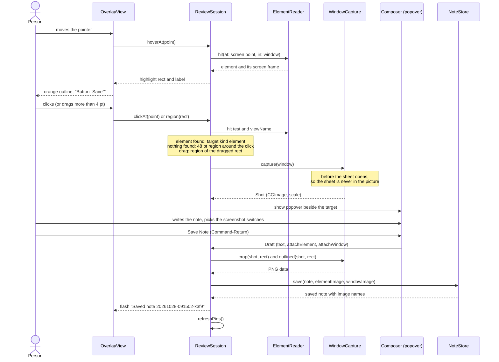

A click with no element under it still makes a note, on a 48 pt square around the point, so nothing
on screen is out of reach. The sheet shows the two pictures exactly as they will be saved, the crop
and the outlined window, each with the checkbox that keeps it; clicking a picture flips it. The
switches remember their last state in `UserDefaults` (`TincanAttachElement`, `TincanAttachWindow`),
and a picture that could not be taken shows "Not captured" with its checkbox disabled and the reason.

### Opening a note again

The same `Composer` opens a note already left, in one of three modes:

| Mode | Opened by | Shows | Buttons |
|---|---|---|---|
| `new` | a click or drag | the picture as it will be saved, target, place, the window chip | Save Note or Send Note |
| `open` | an open pin, Edit Note… | its picture, its words to rewrite, its age, edits and agent | trash, Resolve, Save |
| `resolved`, a fix to check | a green pin, Check Fix…, checking fixes | before and after, the agent's summary | trash, Skip (while checking), Still Wrong…, Looks Right |
| `resolved`, checked | a grey pin, Reopen… | before and after, the summary, a field for what is still wrong | trash, Reopen |

Saving rewrites the note with `NoteStore.edit`, which keeps the old words in the history. Each mode
offers the send switch, and checking it queues the note for the agent again with `NoteStore.send`,
even one already handed over. Delete is a trash icon that asks again in place.

The sheet has no Cancel button. Escape closes it, and so does a click on the overlay outside it while
its words are untouched; with words typed, that click is ignored and the bottom line says how to put
the note aside. Words in a cancelled sheet are kept in the session by what they were written about
(the spot, or the note) and come back when a sheet opens there again; any other new sheet offers them
back with one click.

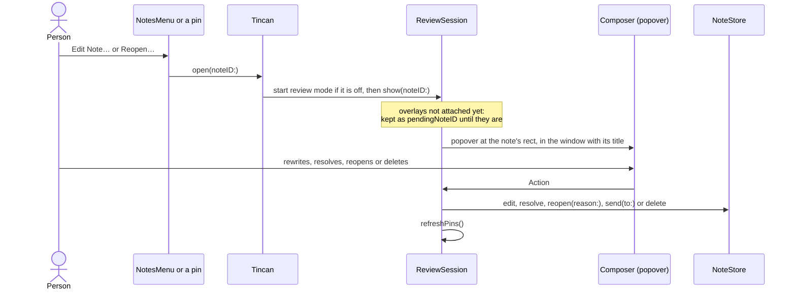

Edit Note… and Reopen… are disabled, with the reason, while another note is open or when the note's
window is not.

## Finding the element under the pointer

SwiftUI does not build its accessibility tree until an accessibility client contacts the app. Until
then, a hit test on a SwiftUI window answers only with the `NSHostingView`. Tincan wakes it by being
that client, once, for itself.

A sheet the app opens on a window, such as a SwiftUI `.sheet` or an `NSAlert` run as a sheet, is a
window of its own: its controls are not in the window's tree, and a picture of the window alone shows
what is behind it. So the window that answers for a point is the front-most visible sheet attached to
the window whose frame holds the point, and the window's picture is taken from that sheet down. A
note left on a sheet still belongs to the window under it, the one its overlay covers.

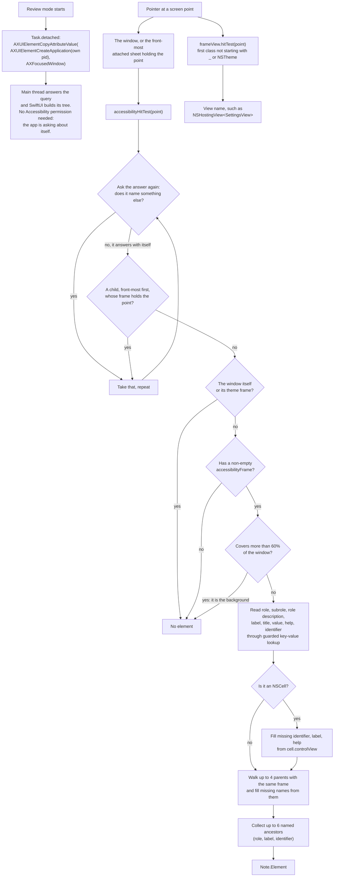

The window's first answer is only a start. SwiftUI's scroll view (`HostingScrollView`) answers
every point inside it with itself, though its contents sit in the tree beneath it; the accessibility
server, and so VoiceOver, keeps going from there, and so does `ElementReader.deepest`. Stopping at the
first answer made every page that scrolls one unpickable element.

Tincan names what the app reports to accessibility, which is exactly what VoiceOver reads, and two
things reach past it.

**Every layer, from the innermost out.** Under any point there is a stack: the innermost element and
each ancestor with a frame of its own (`ElementReader.chain`), up to but not including the window.
Ancestors that only repeat the frame below them are folded in, since their names already went into
it. Hover starts on the innermost layer; ↑ steps out to the parent and ↓ back in, the label previews
what ↑ would choose, and a click notes the layer that is outlined. Moving onto a different innermost
layer starts again from the innermost. Over empty space the innermost layer is a dashed 48 pt spot
(`Geometry.spot`), so the containers around it are still a ↑ away.

**Text inside an element that has no parts.** An app may expose a whole row as one button whose
label is every word in it: one stop for VoiceOver, and nothing smaller in the tree. The words are
still drawn, so `ScreenText` reads the lines inside such an element from the window's own pixels
with Vision, once per element and again after two seconds, off the main thread. The line under the
pointer becomes the innermost layer. Its note element has the role description "text read from the
screen" and the element it sits in as its first ancestor, because recognition can misread a
character the app itself would not.

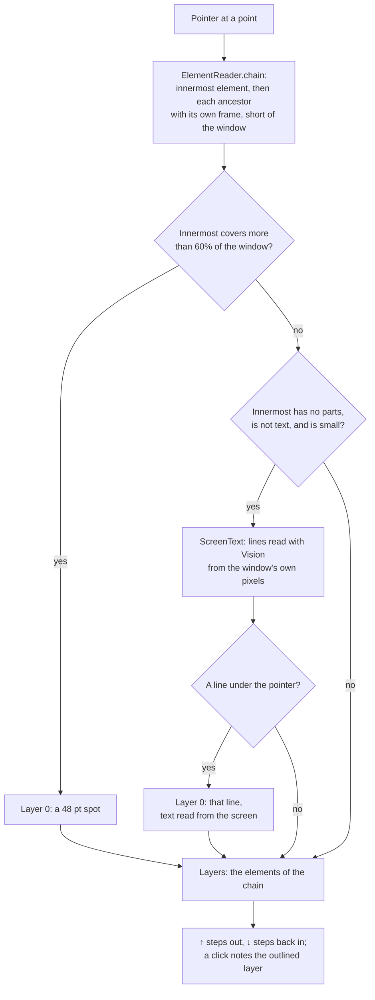

SwiftUI's accessibility nodes implement the `accessibility…` methods without declaring
`NSAccessibilityProtocol`, so every read is `responds(to:)` followed by `value(forKey:)`. A dynamic
call through `AnyObject` would send selectors to objects of the wrong type and crash.

## Taking the screenshots

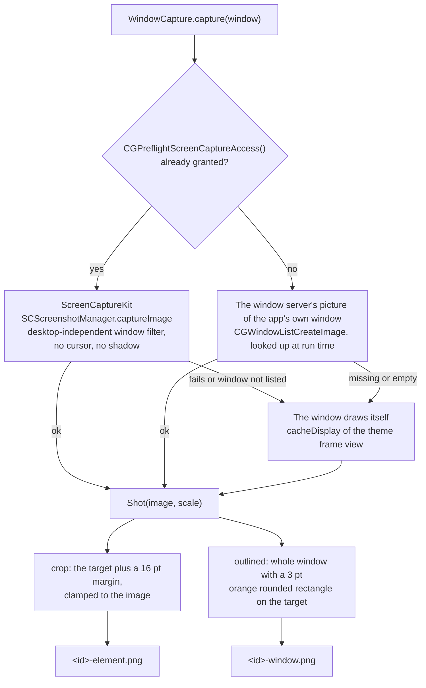

Tincan never asks for Screen Recording permission. A review tool that raises a privacy prompt in the
app under review changes the thing being reviewed. Without it, the window server still gives an app
the pixels of its own windows through `CGWindowListCreateImage`. Swift marks that function
unavailable from the macOS 15 SDK in favour of ScreenCaptureKit, but CoreGraphics still exports it,
so Tincan looks it up with `dlsym` and falls through if a later macOS drops it. The last resort,
`cacheDisplay`, only reaches views that draw in `draw(_:)`: SwiftUI renders through layers, so that
picture keeps the AppKit chrome and loses everything SwiftUI drew.

## Checking a window

`tincan check` asks the running app to check its own windows, because only the app can see what
pointing at them returns. The command posts a distributed notification carrying the store's path;
the app whose Tincan writes to that store answers, and the command prints the report it writes to
`.tincan/checks/`.

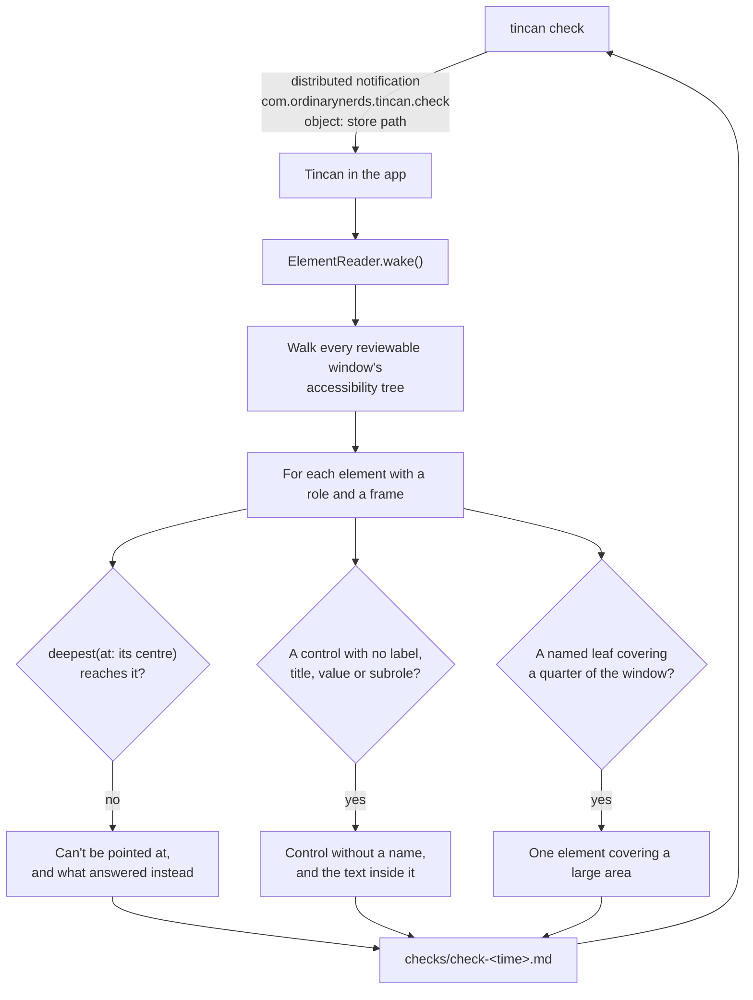

Scroll bar parts are skipped, since they float over content only while scrolling. Text inside a
control's frame, such as a field's placeholder, counts as reached when the control is.

## Coordinates

Every rect in a note is in the window's own points, measured from its top-left corner. That is the
system a person describes ("near the top right") and the one SwiftUI layout code uses.

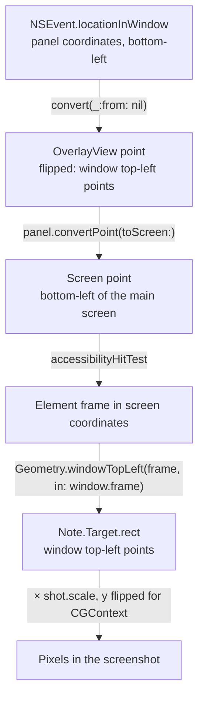

The overlay panel has exactly the window's frame and is flipped, so a point in the overlay view is
already a point in the note's coordinate system.

## Keys and the pointer

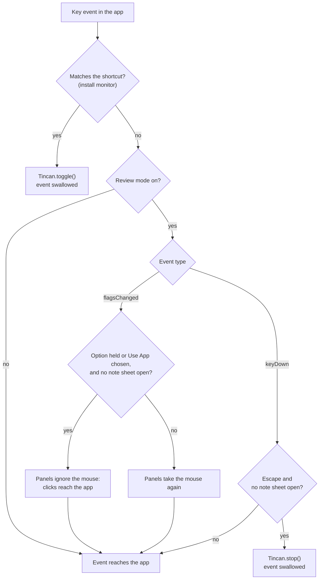

The overlay panels are borderless and non-activating, so the app keeps key focus and its own
keyboard shortcuts keep working during review. Pointer events go to the panel, which is why review
clicks never press the app's buttons.

## Pins, the notes list and the menu bar switch

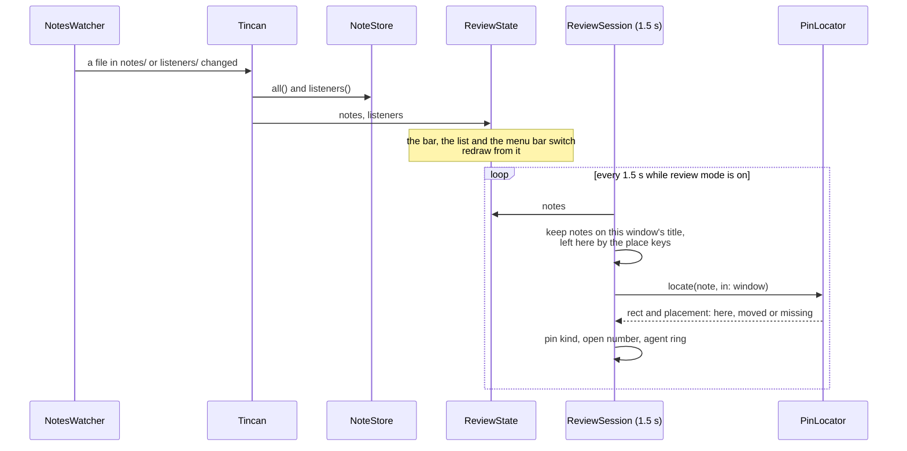

**Reading notes.** `NotesWatcher` watches the `notes` and `listeners` folders with a dispatch source,
so a note an agent resolves leaves the app within a fifth of a second. Every store write renames a
file into its folder, which is an event on the folder. A 5 s timer remains for listener leases, which
expire without a write. `ReviewState` holds the notes and listeners; nothing else reads the disk to
draw.

**Where a pin goes.** A note records a rect, but windows scroll, resize and reflow. `PinLocator`
finds the element again from `Note.Element.anchor`: the identifier when there is one, otherwise the
role and name, and for a line of text read off the screen, the element holding it. It hit-tests the
recorded spot first, which is cheap, then walks the window's tree (up to 6,000 elements) and keeps the
match nearest the recorded spot. Walks are cached for 3 s per note, and forgotten when the context
changes. The result is `here`, `moved` (the pin follows) or `missing` (the pin is drawn hollow and
says so). A cell is read through its control, as everywhere else, since AppKit reports a button's
cell and the identifier sits on the button.

**Which pins show.** A note is pinned on the window with its title, and only where it was left:
`Note.isLeft(in:keys:)` compares the note's context with the app's now, on `placeKeys` or on every
entry. Open notes are numbered as in `tincan list`. Fixes to check are green with a check and always
shown; other resolved notes are grey and shown with Show Resolved Pins (`TincanShowsResolved`).

| Pin | Means |
|---|---|
| Orange, numbered | Open |
| Hollow, dashed | Open, and its element can't be found here any more |
| Dashed ring | Sent to an agent that has not picked it up |
| Widening ring | Handed to an agent that is working now; still with Reduce Motion |
| Green, check | Fixed by an agent, waiting to be checked |
| Grey, check | Resolved |

**Reaching pins.** Clicking a pin opens its sheet; right-clicking opens its actions. Tab and Shift-Tab
step through the pins of the key window in reading order, drawing a focus ring, and Return or Space
opens the one chosen. Each pin is an accessibility button named by its banner, so VoiceOver lists and
presses them.

**One list of actions.** `NoteAction.all(for:store:)` defines everything that can be done to a note:
Edit Note… (Check Fix… or Reopen… once resolved), Mark as Resolved or Looks Right, Reopen Without a
Reason, Send to each listening agent, Copy Note ID, Copy “tincan show <id>”, Delete Note. A pin's
menu, a row's context menu in the list and the menu bar switch's menu all draw from it.

**The notes list.** `NotesPanel` shows `NotesList` in a popover from the floating bar's notes button
or a click on the menu bar switch. Its tabs are Open, To Check and Resolved; it opens on To Check when
a fix is waiting. A row shows the note's picture (the after picture once there is one), its words,
and one line on where it is and who has it. Its footer says who is listening and starts or stops
review mode; its ⋯ menu holds Show Resolved Pins, Copy “tincan list”, Show Notes in Finder and the
floating bar switch.

The menu bar switch shows `mappin.circle` when review mode is off and an orange filled
`mappin.circle.fill` when it is on, with the open count and `✓` and the fixes to check beside it. A
right click opens `NotesMenu`, the same reach as a menu.

## Checking fixes

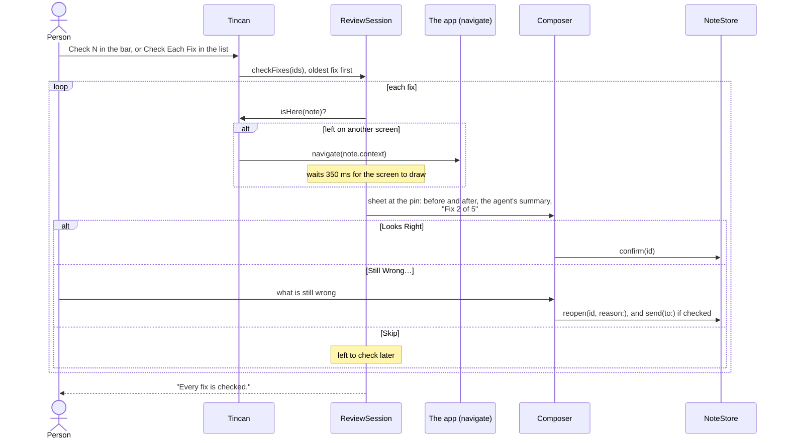

A fix is a note whose last event is `resolved`: an agent resolved it and nobody has looked. Resolving
in the app records `confirmed` straight after, since the person has looked. A note resolved before
history existed is never a fix to check.

The after picture is taken by `AfterPictures` as a fix's sheet opens, when the app is on the screen
the note was left on and its element is found; the sheet waits for it. It is taken then and not when
the agent resolves the note, because the build running at that moment may predate the fix, and the
build on screen while the person checks is the one they are judging. It is cropped with the same margin as the element picture so
the two compare, and saved as `<id>-after.png` with `images.after` and `images.afterAt`. Without a
`navigate` closure, a fix on another screen still opens, centred in its window, and says where it was
left.

## The floating bar

Everything the keys do, with the pointer alone.

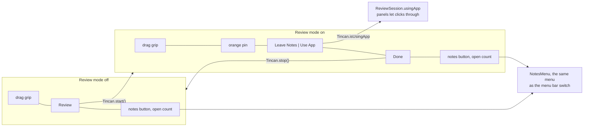

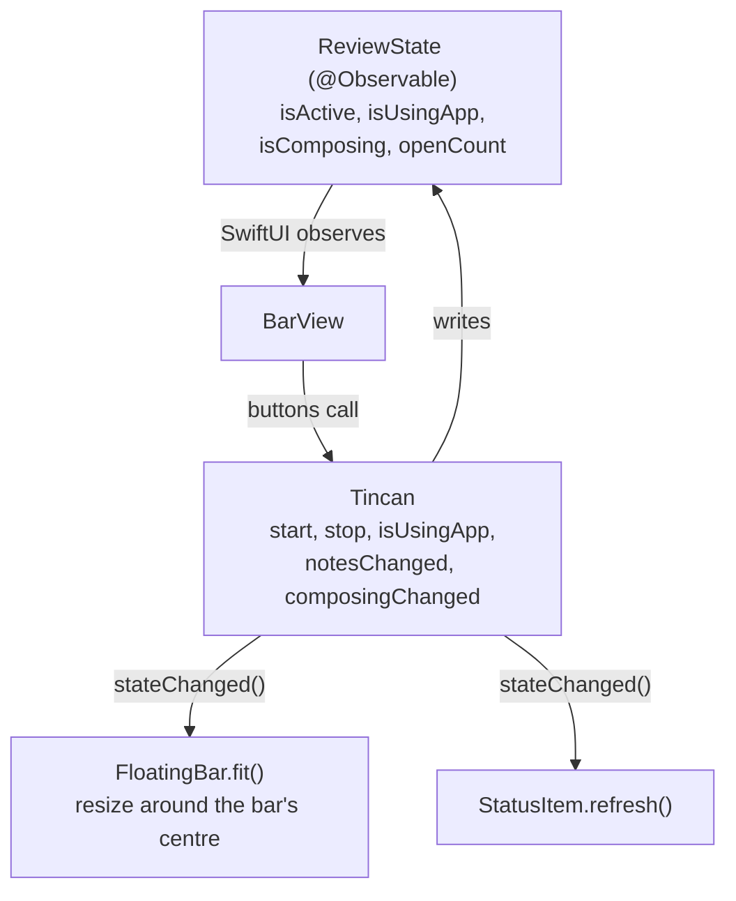

- **Its own panel.** A borderless, non-activating `NSPanel` at the floating level that can never be
  key or main, so clicking it leaves the app's window focused. Review mode only attaches overlays to
  windows that are not panels, so the bar never gets one, and window captures never include it.
- **First click works.** The hosting view and the drag area accept the first mouse, so a control works
  without bringing the bar forward first.
- **Where it sits.** Centred 12 pt below the menu bar at first, clear of the Dock and of the
  instructions along the bottom of each window. Dragging anywhere that is not a control
  moves it, and its origin is saved in `TincanFloatingBarOrigin`. A saved spot that is no longer
  fully on a screen is ignored, so unplugging a display cannot strand it.
- **When it shows.** It hides while the app is in the background and comes back with it. Hiding it
  from the notes menu is remembered in `TincanFloatingBarHidden`; Show Floating Bar in the menu bar
  switch brings it back. When the switch is off, Hide is disabled and says why, because the bar would
  be the only way back without the keyboard.
- **While a note is open.** Use App and Done are disabled and say "Finish or cancel the note first",
  because the note sheet belongs to the overlay and closing review mode would throw the words away.

## Where notes are stored

The app and the command run the same rule from different starting points: the app starts at the
source file that called `install` (`#filePath`, known at compile time), the command starts at its
current directory. In a normal checkout both arrive at the same `.tincan/`.

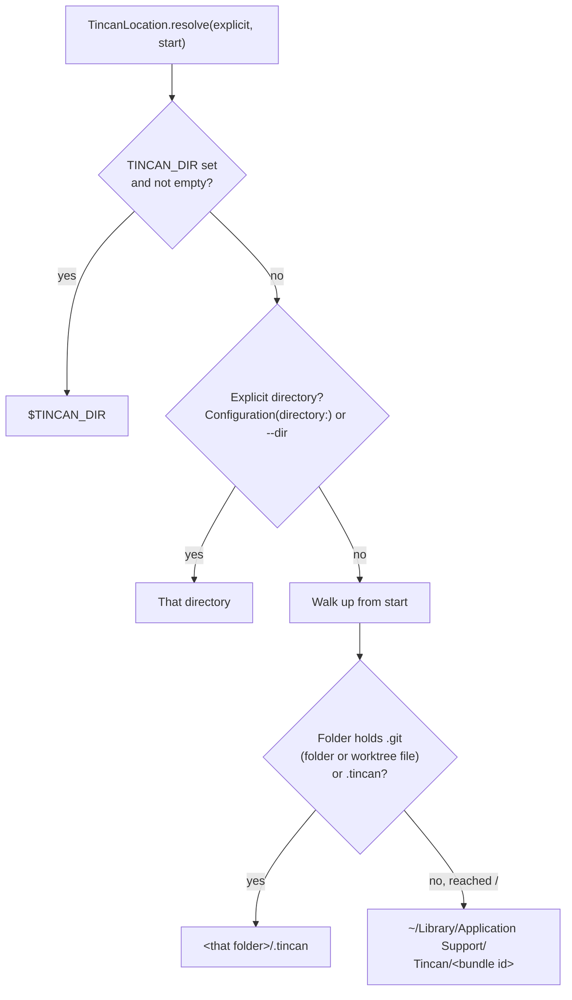

A sandboxed app cannot write into the repository, so it needs `TINCAN_DIR` pointing inside its
container, and the agent needs the same variable.

## The note on disk

```text
.tincan/
├── .gitignore                        "*"  (the folder ignores itself)
├── notes/
│   └── 20261028-091502-k3f9.json
├── listeners/
│   └── claude.json                   who is listening, kept fresh by tincan watch
└── images/
    ├── 20261028-091502-k3f9-element.png
    └── 20261028-091502-k3f9-window.png
```

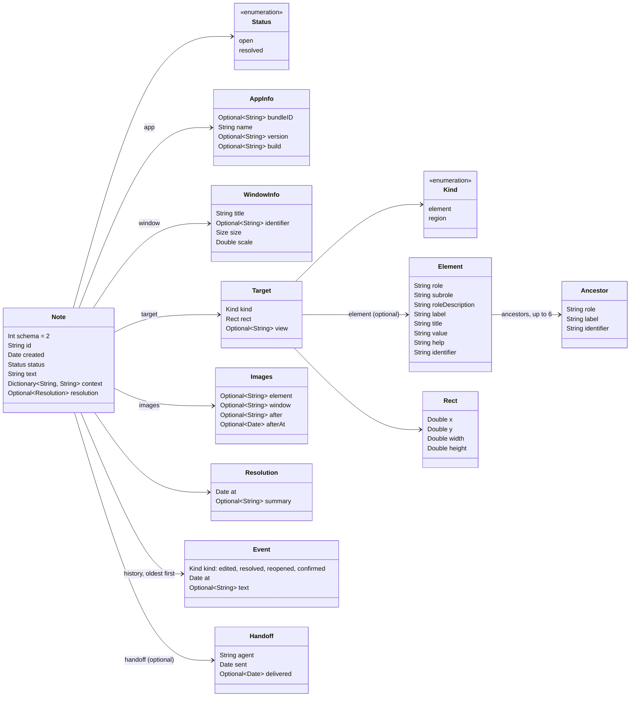

`history` records every edit (its `text` is the wording replaced), resolution (the summary),
reopening (what is still wrong) and confirmation (the person checked the fix). Reopening moves the resolution into the history instead of dropping
it, so a note that comes back still says which fix did not hold. Schema 2 added `history`; a schema 1
file reads with an empty one.

Every `Element` field is optional; a SwiftUI shape with no label may carry only a role. Ids are
`yyyyMMdd-HHmmss-xxxx` in UTC, so they sort by time and can be typed by their last four characters.

Writes are ordered and atomic so the two halves never need a lock:

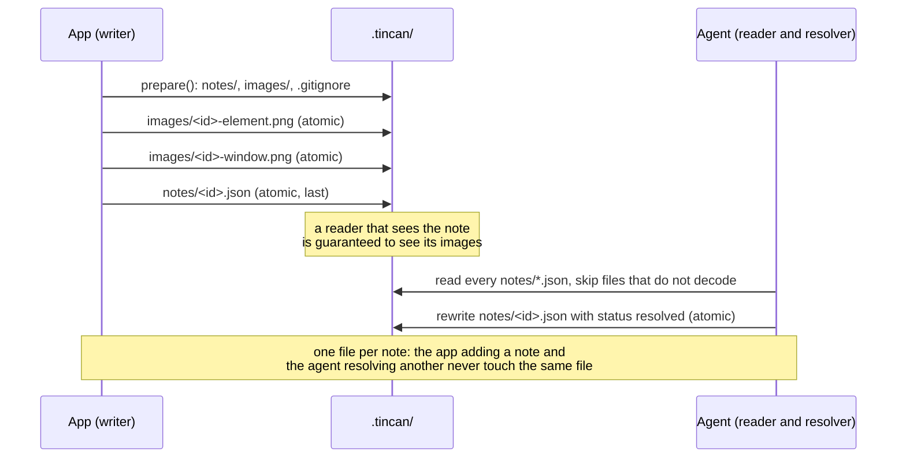

## An agent working through notes

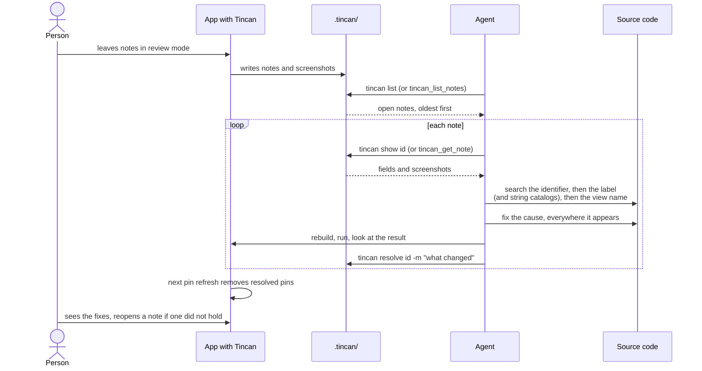

## Sending a note to a listening agent

An agent that wants notes while the person is still reviewing listens under its name. The note
sheet offers to send only to a listener that is live, so the switch never promises a delivery
nobody will pick up.

```mermaid
sequenceDiagram
    actor P as Person
    participant App as Note sheet
    participant F as .tincan/
    participant W as tincan watch --as Claude --once
    participant Ag as Claude

    Ag->>W: starts it in the background
    loop every second
        W->>F: listeners/claude.json, state waiting, live for 8 s
        W->>F: any open note sent to Claude and not yet delivered?
    end
    P->>App: clicks something, writes the note
    App->>F: reads live listeners
    App-->>P: "Send to Claude now" (checked if it was last time)
    P->>App: Send Note
    App->>F: notes/id.json with handoff agent Claude, delivered nil
    W->>F: finds it, sets delivered
    W->>F: listeners/claude.json, state working, live for 30 min
    W-->>Ag: prints the note and exits
    Ag->>Ag: fixes it, rebuilds, looks
    Ag->>F: tincan resolve id -m "what changed"
    Ag->>W: starts it again
```

```mermaid
flowchart TD
    sheet["Note sheet opens"] --> live{"Live listeners<br/>(until is in the future)"}
    live -- none --> off["Send to your agent now: off, disabled,<br/>with how to start a listener underneath"]
    live -- one --> one{"Its state"}
    one -- waiting --> now["Send to Claude now"]
    one -- working --> next["Send to Claude, next after the note it is on"]
    live -- several --> pick["Send now to: Nobody, Claude, Codex…"]
    now --> saved["Saved with handoff.agent"]
    next --> saved
    pick --> saved
    saved --> queue["Waits until that agent's watch hands it over,<br/>oldest first, never lost if the agent is away"]
```

- **Leases, not processes.** A listener is a file with a name, a state and an `until` time. `watch`
  pushes `until` 3 intervals plus 5 s ahead while it polls, so a killed watcher disappears from the
  sheet within seconds. After `--once` hands over a note, `until` moves 30 minutes ahead in state
  `working`, because the agent is busy fixing it and will listen again.
- **A queue on disk.** Sending sets `handoff` on the note; delivery sets `handoff.delivered`. A note
  sent to an agent that is away stays in the queue and is the first thing its next `watch` prints.
  It is still an ordinary open note, so `tincan list` shows it too, marked "Sent to: Claude".
- **Why `--once`.** Many agents are told when a background command ends, not when it prints. Exiting
  after each note turns "a note arrived" into "the command finished", which every agent understands.
  Without `--once`, `watch` keeps printing, for agents that can follow a stream.
- **Names, not vendors.** Tincan does not know Claude, Codex or Cursor. The name is whatever the agent
  passes with `--as` (or `TINCAN_AGENT`), and it is matched without regard to case.
- **Tincan never starts an agent.** Sending only marks the note. Launching a second agent from the app
  would put two sessions editing the same repository at once.

`tincan watch --all` also prints new notes nobody sent, for an agent that wants everything.

## The MCP server

`tincan mcp` speaks the Model Context Protocol over stdio: one JSON-RPC message per line on stdin,
one reply per line on stdout, nothing else on stdout. It is written by hand on Foundation so the
package keeps no dependencies.

```mermaid
sequenceDiagram
    participant C as MCP client
    participant S as tincan mcp
    participant D as NoteStore

    C->>S: initialize (protocolVersion)
    S-->>C: echoed version if supported, else 2025-06-18<br/>capabilities.tools, serverInfo, instructions
    C->>S: notifications/initialized
    Note over S: notifications get no reply
    C->>S: tools/list
    S-->>C: four tools with schemas and annotations
    C->>S: tools/call tincan_list_notes {status, limit, offset}
    S->>D: notes(status:)
    S-->>C: text page plus structuredContent<br/>{total, count, offset, has_more, next_offset, notes}
    C->>S: tools/call tincan_get_note {id}
    S->>D: note(matching:), imageURL
    S-->>C: text, then each screenshot as an image block,<br/>scaled to 1200 px (element) and 1600 px (window)
    C->>S: tools/call tincan_resolve_note {id, summary}
    S->>D: resolve(id, summary)
    S-->>C: "Resolved id"
```

```mermaid
flowchart TD
    line["A line on stdin"] --> blank{"Blank?"}
    blank -- yes --> skip["Skip"]
    blank -- no --> parse{"Valid JSON object?"}
    parse -- no --> perr["-32700 parse error, id null"]
    parse -- yes --> method{"Has a method?"}
    method -- no --> inv["-32600 invalid request<br/>(no reply without an id)"]
    method -- yes --> idq{"Has an id?"}
    idq -- "no: a notification" --> silent["No reply"]
    idq -- yes --> route{"Method"}
    route -- initialize --> init["Version, capabilities, instructions"]
    route -- ping --> pong["Empty result"]
    route -- "tools/list" --> list["Tool definitions"]
    route -- "tools/call" --> known{"Known tool?"}
    known -- no --> unknown["-32602 unknown tool"]
    known -- yes --> run["Run the tool"]
    run --> ok["result.content"]
    run -- "bad arguments, note not found,<br/>ambiguous id, empty summary" --> toolerr["result.isError = true<br/>with a message that says what to do next"]
    route -- other --> nf["-32601 method not found"]
```

| Tool | Read only | Arguments | Returns |
|---|---|---|---|
| `tincan_list_notes` | yes | `status` open, resolved or all; `limit` 1 to 100; `offset` | A page of notes as text and as structured content |
| `tincan_get_note` | yes | `id`; `include_images` | The full note and both screenshots as images |
| `tincan_resolve_note` | no | `id`; `summary` (required) | Confirmation |
| `tincan_reopen_note` | no | `id` | Confirmation |

Protocol mistakes (unknown method, unknown tool) are JSON-RPC errors. Mistakes an agent can correct
(a wrong id, a missing summary) are tool results with `isError`, so the model reads the message and
tries again. Deleting is not offered over MCP; an agent should not be able to throw a note away.

## Threads and actors

```mermaid
flowchart LR
    subgraph main["@MainActor"]
        tincan["Tincan"]
        session["ReviewSession"]
        overlay["OverlayView"]
        reader["ElementReader"]
        capture["WindowCapture"]
        status["StatusItem"]
        bar["FloatingBar, BarView"]
        state["ReviewState"]
        composer["Composer and ComposerParts (SwiftUI)"]
    end
    subgraph bg["Off the main thread"]
        wake["Task.detached: the wake query"]
        sck["ScreenCaptureKit work<br/>awaited from the main actor"]
    end
    subgraph any["Sendable, any thread"]
        store["NoteStore"]
        note["Note"]
        location["TincanLocation"]
    end
    subgraph proc["Separate process"]
        cli["tincan / tincan mcp<br/>single-threaded loop"]
    end
    session --> wake
    capture --> sck
    session --> store
    cli --> store
```

Everything that touches AppKit is on the main actor. The wake query has to run off it: it is a
question the main thread must answer, so asking from the main thread would wait on itself. AppKit
callbacks (notifications, event monitors, timers) arrive on the main queue and enter the actor with
`MainActor.assumeIsolated`, extracting non-Sendable values such as `NSEvent` fields first.

## What Tincan deliberately does not do

| Not done | Why |
|---|---|
| Ask for Accessibility or Screen Recording permission | A prompt in the app under review changes what is being reviewed. Both features work without it. |
| Change the app's view hierarchy | The overlay is a separate child window; removing it leaves the app exactly as it was. |
| Run in release builds | The host app wraps `install` in `#if DEBUG`. |
| Talk to the network | Notes stay on disk, and the folder ignores itself in git. |
| Let an agent delete notes over MCP | Deleting is for the person, in the app or the command line. |
| Start an agent when a note is sent | Sending only marks the note; a listening agent picks it up. A second session started from the app would edit the repository alongside the one already working there. |
| Depend on any package | The MCP server and everything else use Apple frameworks only. |
