# How Tincan works

Tincan has two halves that never talk to each other directly. A library inside the app under review
writes notes to a folder; a command that an agent runs reads them from the same folder. The folder is
the whole interface between them, so either half can be replaced, and the agent never needs the app to
be running.

- [The whole system](#the-whole-system)
- [Packages and targets](#packages-and-targets)
- [Review mode, from start to stop](#review-mode-from-start-to-stop)
- [Leaving a note](#leaving-a-note)
- [Finding the element under the pointer](#finding-the-element-under-the-pointer)
- [Taking the screenshots](#taking-the-screenshots)
- [Coordinates](#coordinates)
- [Keys and the pointer](#keys-and-the-pointer)
- [Pins and the menu bar switch](#pins-and-the-menu-bar-switch)
- [The floating bar](#the-floating-bar)
- [Where notes are stored](#where-notes-are-stored)
- [The note on disk](#the-note-on-disk)
- [An agent working through notes](#an-agent-working-through-notes)
- [The MCP server](#the-mcp-server)
- [Threads and actors](#threads-and-actors)
- [What Tincan deliberately does not do](#what-tincan-deliberately-does-not-do)

## The whole system


The app and the command agree on the folder by running the same resolution rule
([Where notes are stored](#where-notes-are-stored)), not by talking to each other.

## Packages and targets

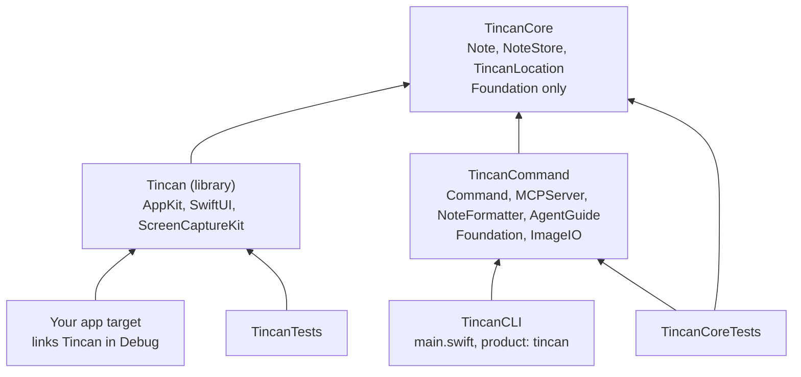

| Target | Product | Depends on | Holds |
|---|---|---|---|
| `TincanCore` | library `TincanCore` | Foundation | The note format, the store, the folder rule. Shared by both halves. |
| `Tincan` | library `Tincan` | `TincanCore`, AppKit, SwiftUI, ScreenCaptureKit | Everything that runs inside the app. |
| `TincanCommand` | none | `TincanCore`, ImageIO | The command and the MCP server, kept out of `main.swift` so tests can drive them. |
| `TincanCLI` | executable `tincan` | `TincanCommand` | One line: run the command with the process arguments. |

The executable target is named `TincanCLI` rather than `tincan` because macOS file systems are case
insensitive, and `Sources/tincan` would be the same folder as `Sources/Tincan`.

## Review mode, from start to stop

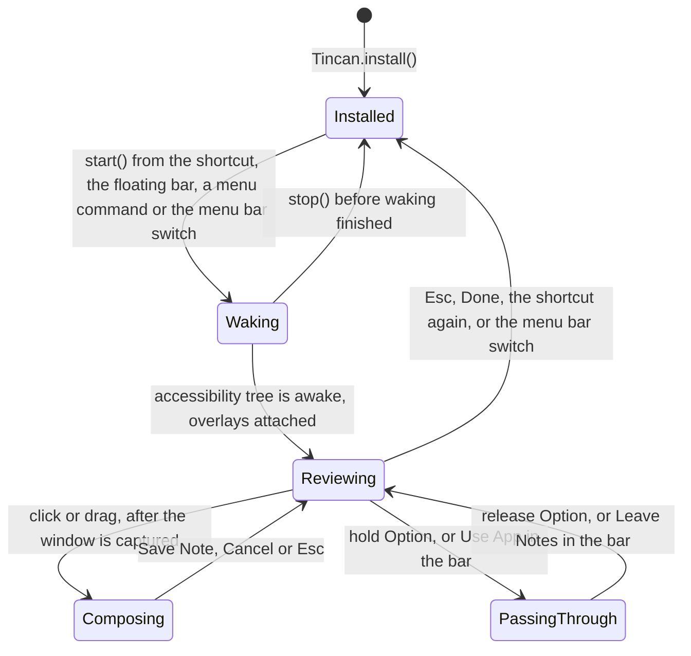

`install` creates the store, the menu bar switch and the shortcut monitor once. Each `start` creates a
fresh `ReviewSession`; `stop` tears all of it down: overlays, observers, the key monitor, the pin timer
and any open note sheet.

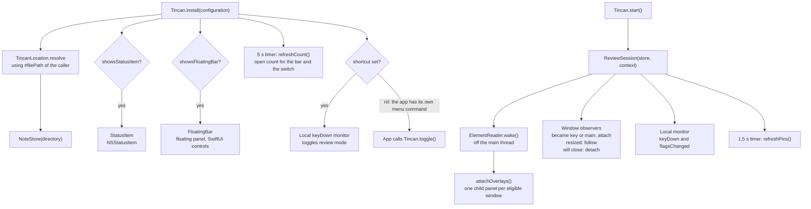

A window is eligible when it is visible, titled, at the normal level, has a content view, and is not
itself a panel. That keeps overlays off menus, popovers, the note sheet and Tincan's own panels.

## Leaving a note

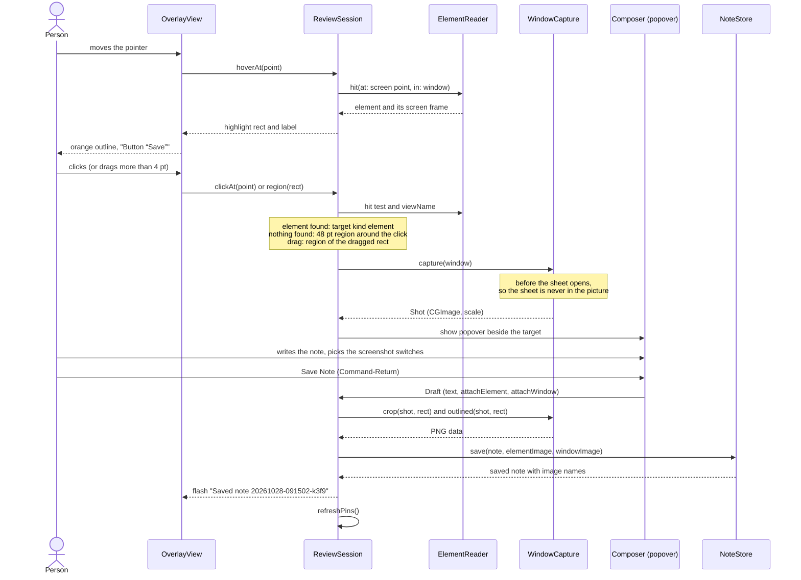

A click with no element under it still makes a note, on a 48 pt square around the point, so nothing
on screen is out of reach. The screenshot switches remember their last state in `UserDefaults`
(`TincanAttachElement`, `TincanAttachWindow`), and are disabled with a reason when the window could not
be captured.

## Finding the element under the pointer

SwiftUI does not build its accessibility tree until an accessibility client contacts the app. Until
then, a hit test on a SwiftUI window answers only with the `NSHostingView`. Tincan wakes it by being
that client, once, for itself.

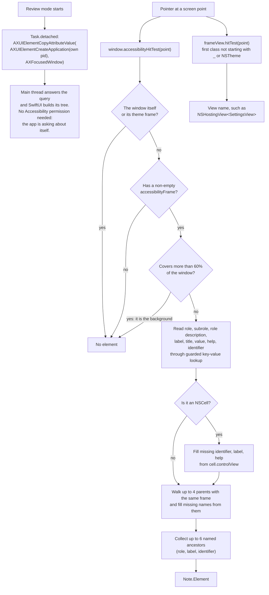

SwiftUI's accessibility nodes implement the `accessibility…` methods without declaring
`NSAccessibilityProtocol`, so every read is `responds(to:)` followed by `value(forKey:)`. A dynamic
call through `AnyObject` would send selectors to objects of the wrong type and crash.

## Taking the screenshots

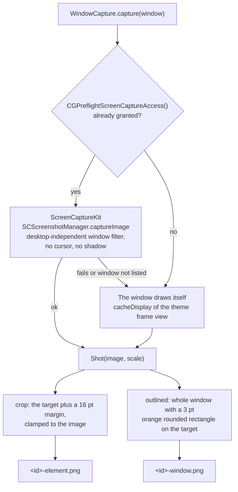

Tincan never asks for Screen Recording permission. A review tool that raises a privacy prompt in the
app under review changes the thing being reviewed. Without the permission the drawn picture is exact
for controls and text; materials and vibrancy can render flatter than on screen.

## Coordinates

Every rect in a note is in the window's own points, measured from its top-left corner. That is the
system a person describes ("near the top right") and the one SwiftUI layout code uses.

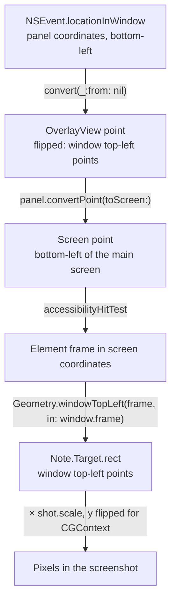

The overlay panel has exactly the window's frame and is flipped, so a point in the overlay view is
already a point in the note's coordinate system.

## Keys and the pointer

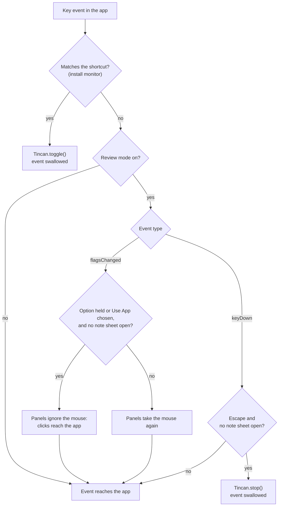

The overlay panels are borderless and non-activating, so the app keeps key focus and its own
keyboard shortcuts keep working during review. Pointer events go to the panel, which is why review
clicks never press the app's buttons.

## Pins and the menu bar switch

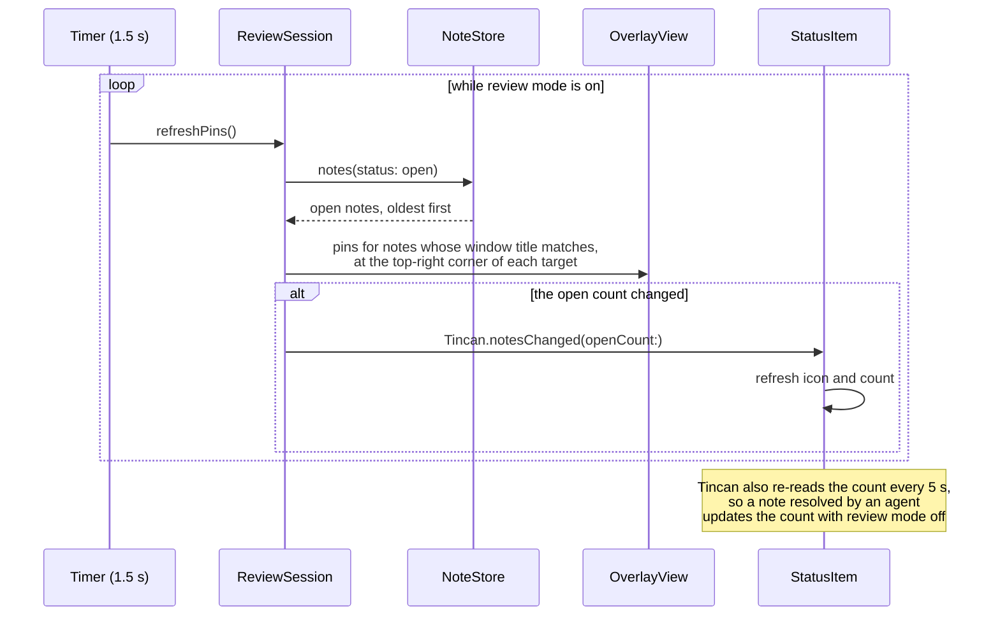

Pins are numbered across all open notes, so pin 3 in the app is the third note in `tincan list`.
Clicking or right-clicking a pin opens Copy Note ID, Mark as Resolved and Delete Note.

The menu bar switch shows `mappin.circle` when review mode is off and an orange filled
`mappin.circle.fill` when it is on, with the open count beside it. Its menu is rebuilt each time it
opens: Start or Stop Review Mode, the last eight open notes (choosing one copies its id), Copy
“tincan list” for Your Agent, Show Notes in Finder, and Show or Hide Floating Bar. `NotesMenu` builds
it, and the floating bar's notes button opens the same menu.

## The floating bar

Everything the keys do, with the pointer alone.

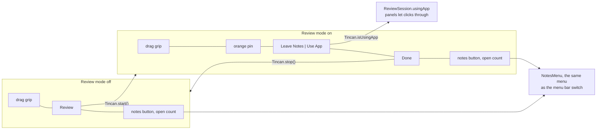

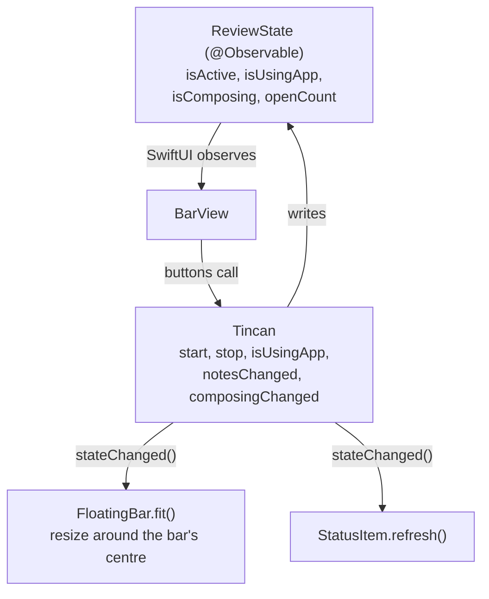

- **Its own panel.** A borderless, non-activating `NSPanel` at the floating level that can never be
  key or main, so clicking it leaves the app's window focused. Review mode only attaches overlays to
  windows that are not panels, so the bar never gets one, and window captures never include it.
- **First click works.** The hosting view and the drag area accept the first mouse, so a control works
  without bringing the bar forward first.
- **Where it sits.** Centred 12 pt below the menu bar at first, clear of the Dock and of the
  instructions along the bottom of each window. Dragging anywhere that is not a control
  moves it, and its origin is saved in `TincanFloatingBarOrigin`. A saved spot that is no longer
  fully on a screen is ignored, so unplugging a display cannot strand it.
- **When it shows.** It hides while the app is in the background and comes back with it. Hiding it
  from the notes menu is remembered in `TincanFloatingBarHidden`; Show Floating Bar in the menu bar
  switch brings it back. When the switch is off, Hide is disabled and says why, because the bar would
  be the only way back without the keyboard.
- **While a note is open.** Use App and Done are disabled and say "Finish or cancel the note first",
  because the note sheet belongs to the overlay and closing review mode would throw the words away.

## Where notes are stored

The app and the command run the same rule from different starting points: the app starts at the
source file that called `install` (`#filePath`, known at compile time), the command starts at its
current directory. In a normal checkout both arrive at the same `.tincan/`.

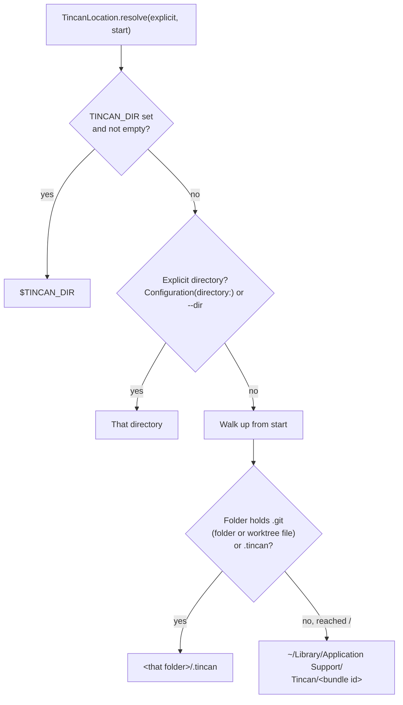

A sandboxed app cannot write into the repository, so it needs `TINCAN_DIR` pointing inside its
container, and the agent needs the same variable.

## The note on disk

```text
.tincan/
├── .gitignore                        "*"  (the folder ignores itself)
├── notes/
│   └── 20261028-091502-k3f9.json
└── images/
    ├── 20261028-091502-k3f9-element.png
    └── 20261028-091502-k3f9-window.png
```

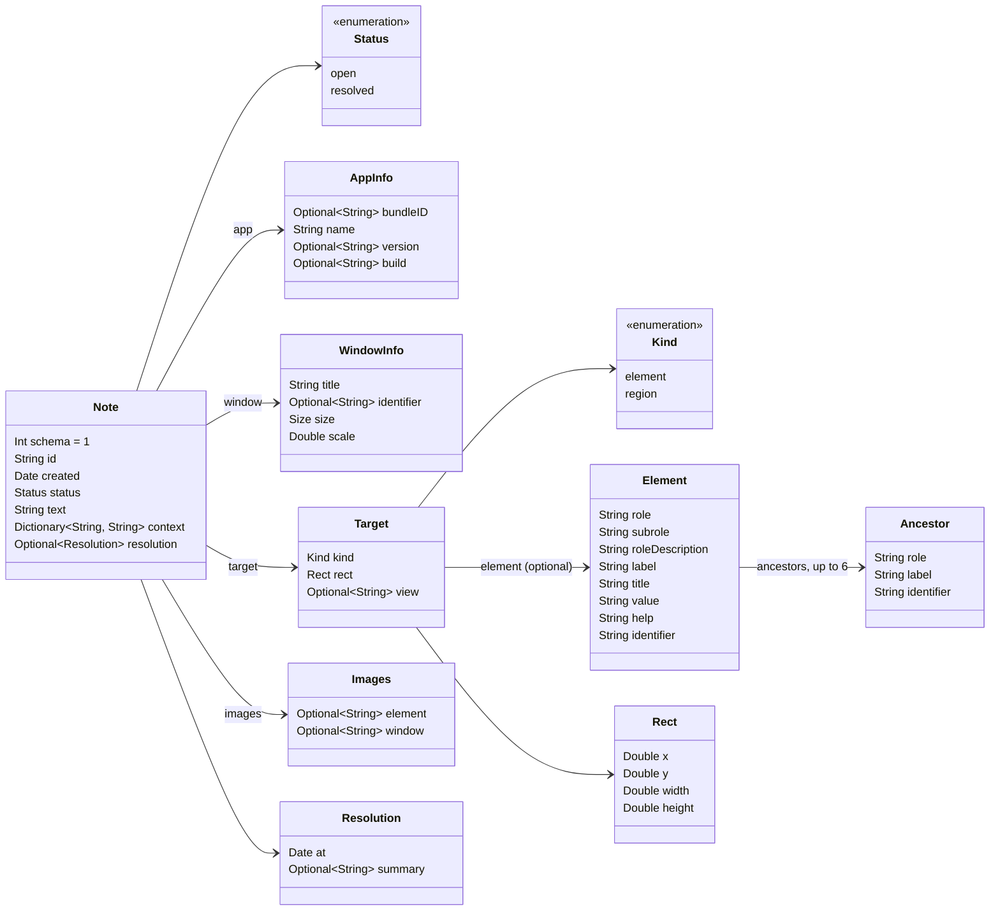

Every `Element` field is optional; a SwiftUI shape with no label may carry only a role. Ids are
`yyyyMMdd-HHmmss-xxxx` in UTC, so they sort by time and can be typed by their last four characters.

Writes are ordered and atomic so the two halves never need a lock:

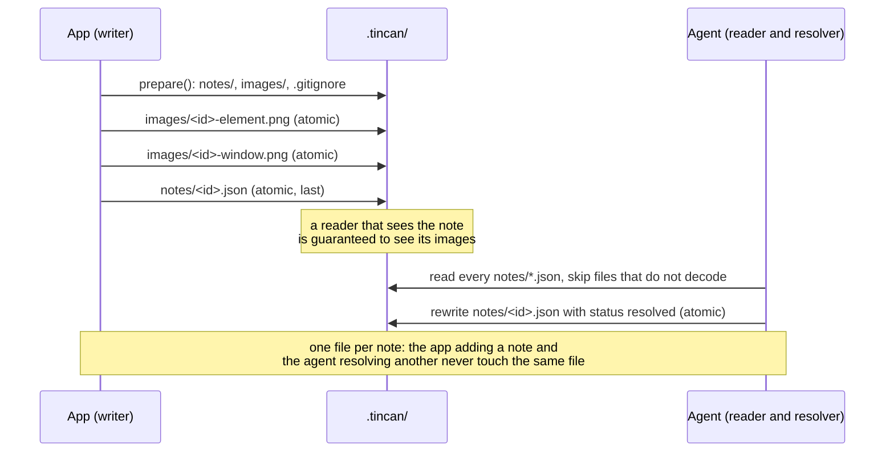

## An agent working through notes

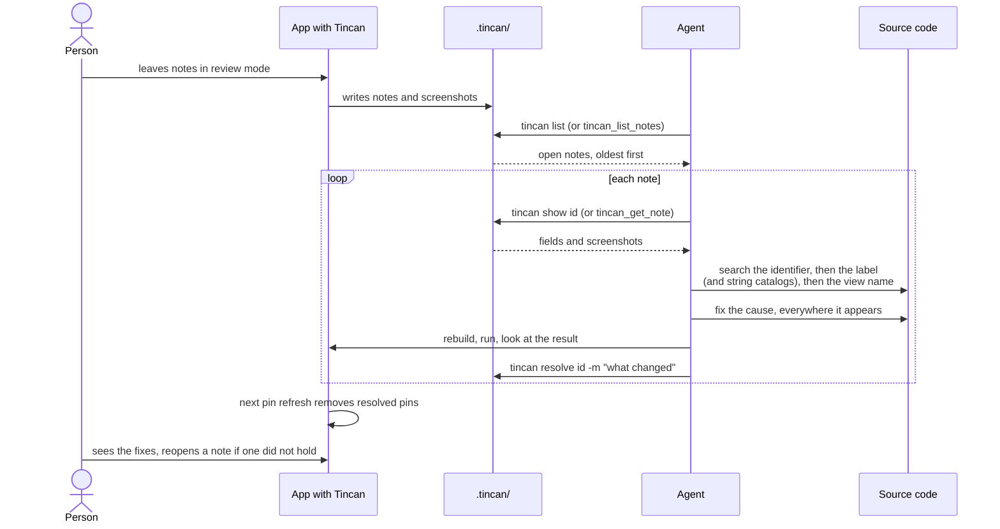

`tincan watch` polls the folder and prints each new open note as it appears, so an agent can work
while the person is still reviewing.

## The MCP server

`tincan mcp` speaks the Model Context Protocol over stdio: one JSON-RPC message per line on stdin,
one reply per line on stdout, nothing else on stdout. It is written by hand on Foundation so the
package keeps no dependencies.

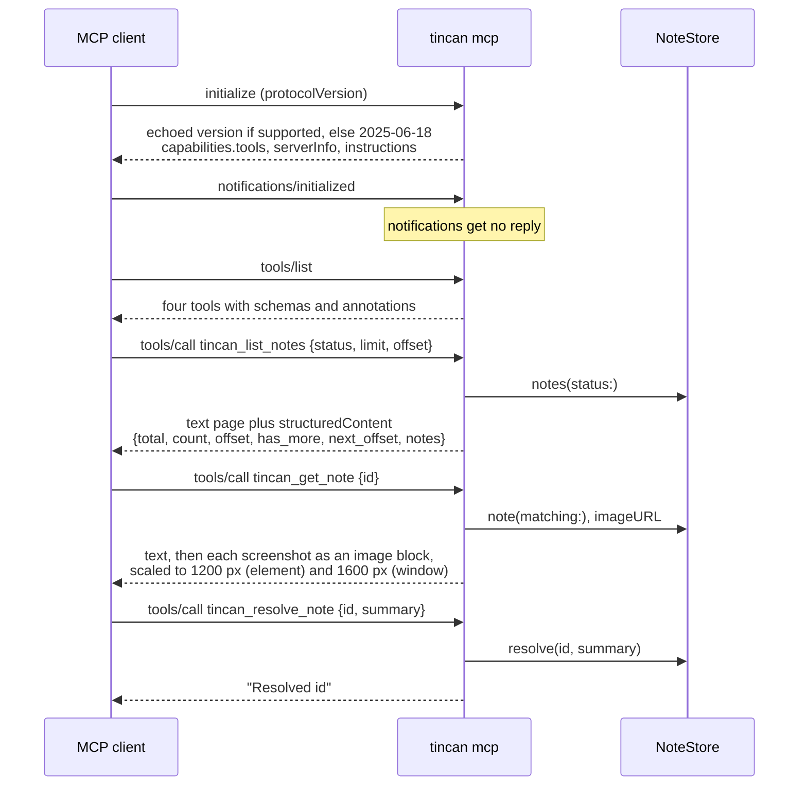

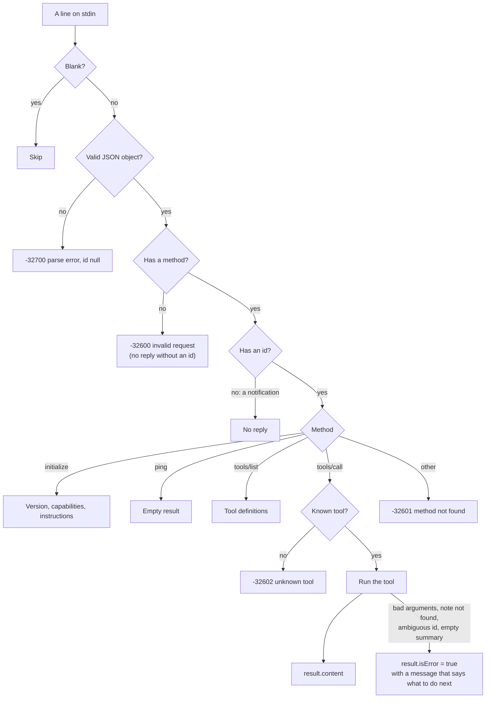

| Tool | Read only | Arguments | Returns |
|---|---|---|---|
| `tincan_list_notes` | yes | `status` open, resolved or all; `limit` 1 to 100; `offset` | A page of notes as text and as structured content |
| `tincan_get_note` | yes | `id`; `include_images` | The full note and both screenshots as images |
| `tincan_resolve_note` | no | `id`; `summary` (required) | Confirmation |
| `tincan_reopen_note` | no | `id` | Confirmation |

Protocol mistakes (unknown method, unknown tool) are JSON-RPC errors. Mistakes an agent can correct
(a wrong id, a missing summary) are tool results with `isError`, so the model reads the message and
tries again. Deleting is not offered over MCP; an agent should not be able to throw a note away.

## Threads and actors

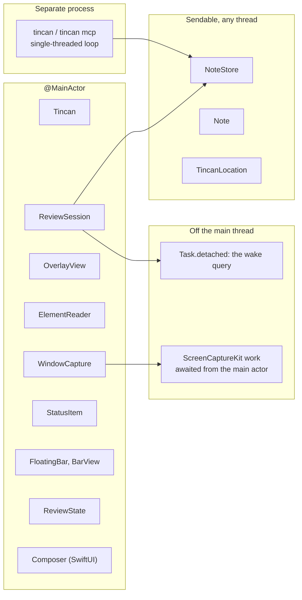

Everything that touches AppKit is on the main actor. The wake query has to run off it: it is a
question the main thread must answer, so asking from the main thread would wait on itself. AppKit
callbacks (notifications, event monitors, timers) arrive on the main queue and enter the actor with
`MainActor.assumeIsolated`, extracting non-Sendable values such as `NSEvent` fields first.

## What Tincan deliberately does not do

| Not done | Why |
|---|---|
| Ask for Accessibility or Screen Recording permission | A prompt in the app under review changes what is being reviewed. Both features work without it. |
| Change the app's view hierarchy | The overlay is a separate child window; removing it leaves the app exactly as it was. |
| Run in release builds | The host app wraps `install` in `#if DEBUG`. |
| Talk to the network | Notes stay on disk, and the folder ignores itself in git. |
| Let an agent delete notes over MCP | Deleting is for the person, in the app or the command line. |
| Depend on any package | The MCP server and everything else use Apple frameworks only. |
